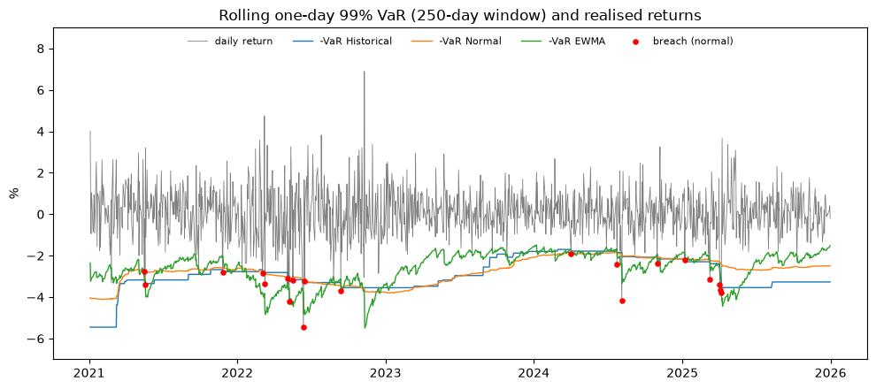

# Portfolio Value at Risk

One-day 99% VaR and expected shortfall (ES) for a EUR portfolio of stocks, a bond ETF and Ethereum. Four models are compared and backtested out of sample.

A short note with the method and results: [note/portfolio-value-at-risk.pdf](note/portfolio-value-at-risk.pdf).

## Method

- Portfolio: the four French stocks LVMH, Sanofi, L'Oréal and Airbus (40% together, 10% each), the three US stocks Apple, Microsoft and NVIDIA (30% together), TLT (20%) and Ethereum (10%). Rebalanced daily to fixed weights.
- USD assets are converted with EURUSD, so FX risk is included.
- Models: historical, normal, Student-t (maximum likelihood) and Monte Carlo with Student-t scenarios. EWMA (lambda 0.94) is added in the backtest.
- Backtest: each day, VaR is estimated on the previous 250 days and compared with the next day's loss. 1,244 days from 2021 to 2025.

## Results

| Model | VaR 99% | ES 99% |
|---|---|---|
| Historical | 3.37% | 4.77% |
| Normal | 2.97% | 3.40% |
| Student-t | 3.37% | 4.63% |
| Monte Carlo (Student-t) | 3.40% | 4.65% |

- Returns have fat tails (excess kurtosis 6.8). The normal model gives a lower VaR and ES than the historical one, so it misses the tails.
- The Student-t model has 12 breaches against 12.4 expected. Normal and EWMA fail the Kupiec test at 5%.
- All four models fail the Christoffersen test: breaches come in clusters in 2022 and April 2025.
- Ethereum is 10% of the capital and 28.3% of the portfolio volatility.



## Data

Yahoo Finance adjusted closes, 2020 to 2025, downloaded with `yfinance`. The sample has 1,494 daily returns (days where every asset has a close).

## Run it

```bash
pip install -r requirements.txt
jupyter notebook portfolio_var.ipynb
```
