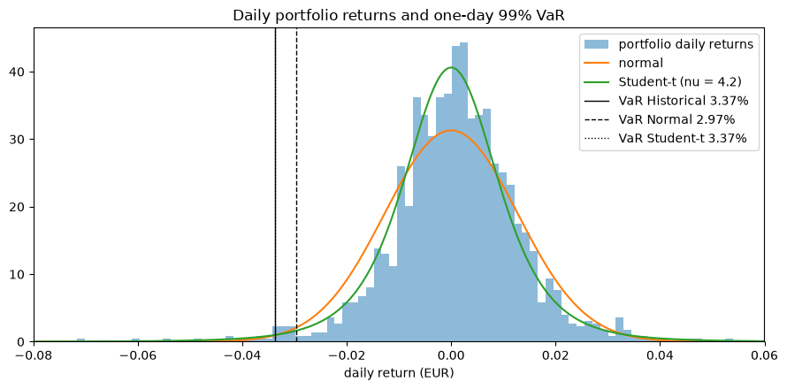

# Portfolio Value at Risk: models and backtest

One-day 99% VaR and Expected Shortfall of a multi-asset portfolio held by a
EUR investor, estimated with four models and backtested out of sample.

[](https://colab.research.google.com/github/gianni04/portfolio-value-at-risk/blob/main/portfolio_var.ipynb)

## Setup

- **Portfolio:** LVMH, Sanofi, L'Oréal, Airbus (40%), Apple, Microsoft, NVIDIA
  (30%), TLT US Treasury ETF (20%), Ethereum (10%). Rebalanced daily to fixed
  weights.
- **Currency:** EUR. USD assets are converted with EURUSD, so FX risk is
  included.
- **Data:** Yahoo Finance adjusted closes, 2020-2025, 1,494 daily simple
  returns (days where every asset has a close).
- **Models:** historical, normal, Student-t (fitted by maximum likelihood),
  Monte Carlo (multivariate Student-t scenarios for the 9 assets). EWMA
  (lambda 0.94) is added in the backtest.

## Full sample

| Model | VaR 99% | ES 99% |
|---|---|---|
| Historical | 3.37% | 4.77% |
| Normal | 2.97% | 3.40% |
| Student-t | 3.37% | 4.63% |
| Monte Carlo (Student-t) | 3.40% | 4.65% |

The normal model gives a VaR 12% lower and an ES 29% lower than the
historical one. Returns have fat tails (excess kurtosis 6.8, fitted Student-t
with 4.2 degrees of freedom), which the Student-t captures. The historical ES
rests on 15 observations and depends on March 2020: without 2020 it falls from
4.77% to 3.70%.



## Backtest

Each day the VaR is estimated on the previous 250 days only and compared with
the next day's loss. 1,244 out-of-sample days (2021-2025), 12.4 breaches
expected at 99%.

| Model | Breaches | Kupiec p | Christoffersen p |
|---|---|---|---|
| Historical | 19 | 0.083 | 0.032 |
| Normal | 20 | **0.048** | 0.039 |
| EWMA | 21 | **0.026** | 0.048 |
| Student-t | 12 | 0.900 | **0.004** |

- The normal and EWMA models are rejected by the Kupiec test at 5%: too many
  breaches. EWMA reacts faster to volatility but keeps normal tails, so it
  does not help here.
- The Student-t model has the right number of breaches.
- All four models fail the Christoffersen test: breaches come in clusters
  (2022 and April 2025), because a 250-day window adapts slowly.


## Risk by asset

| Asset | Weight | Share of portfolio volatility |
|---|---|---|
| Ethereum | 10% | 28.3% |
| NVIDIA | 10% | 18.5% |
| TLT | 20% | 3.2% |

Ethereum is 10% of the capital but more than a quarter of the risk.

## Limitations

- Closing times differ (Paris, New York, and 24/7 for Ethereum), which lowers
  the measured correlations. Ethereum's weekend moves fall on Monday.
- One sample period; the ES estimate is driven by a few crisis days.
- Linear portfolio only (no options).

## Run

Open the notebook in Colab with the badge above, or locally:

```bash
pip install -r requirements.txt
jupyter notebook portfolio_var.ipynb
```
