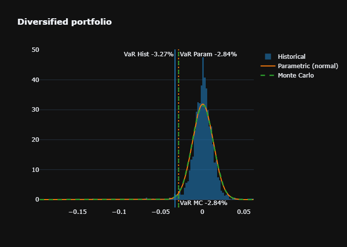

# Portfolio Value at Risk

One-day 99% Value at Risk and Expected Shortfall on real market data, computed
three ways (historical, parametric, Monte Carlo) and compared.

[](https://colab.research.google.com/github/gianni04/portfolio-value-at-risk/blob/main/portfolio_var.ipynb)

## Methods

| Method | How | Assumption |
|---|---|---|
| Historical | 1% quantile of past daily portfolio returns | none on the distribution |
| Parametric | mean and covariance of returns, normal quantile | returns are normal |
| Monte Carlo | 50,000 correlated normal draws (Cholesky of the covariance) | normal, same covariance |

Expected Shortfall (ES, or CVaR) is the average loss beyond the VaR.

Data: daily log returns from Yahoo Finance, January 2020 to December 2025.

## Results (one day, 99%)

| | Historical VaR | Parametric VaR | Monte Carlo VaR | Historical ES | Parametric ES |
|---|---|---|---|---|---|
| UBS Group | -5.64% | -4.86% | -4.89% | -8.51% | -5.58% |
| Bitcoin | -8.91% | -7.42% | -7.41% | -13.24% | -8.51% |
| Diversified portfolio | -3.27% | -2.84% | -2.82% | -5.24% | -3.27% |

Diversified portfolio: LVMH, Sanofi, L'Oréal, Airbus (40%), Apple, Microsoft,
NVIDIA (30%), TLT US Treasury ETF (20%), Ethereum (10%).



## Findings

- The parametric method underestimates large losses. On the diversified
  portfolio the normal VaR is 13% smaller than the historical one, and the
  Expected Shortfall 38% smaller (-3.27% vs -5.24%), because real returns have
  fatter tails than a normal distribution.
- The same holds for each single asset. For Bitcoin the historical Expected
  Shortfall is -13.2% against -8.5% for the normal model.
- Monte Carlo gives almost the same answer as the parametric method, since it
  simulates from the same normal distribution. It would only add something
  with fatter-tailed or non-linear models.

## Limitations

- One fixed window (2020-2025) and no backtest of the VaR against later losses.
- Monte Carlo uses normal shocks, so it has the same thin tails as the
  parametric method.
- The assets trade on different calendars (crypto every day, European and US
  stocks on their own exchanges), so only days where every asset has a price
  are kept.

## Run

Open the notebook in Colab with the badge above, or locally:

```bash
pip install -r requirements.txt
jupyter notebook portfolio_var.ipynb
```
